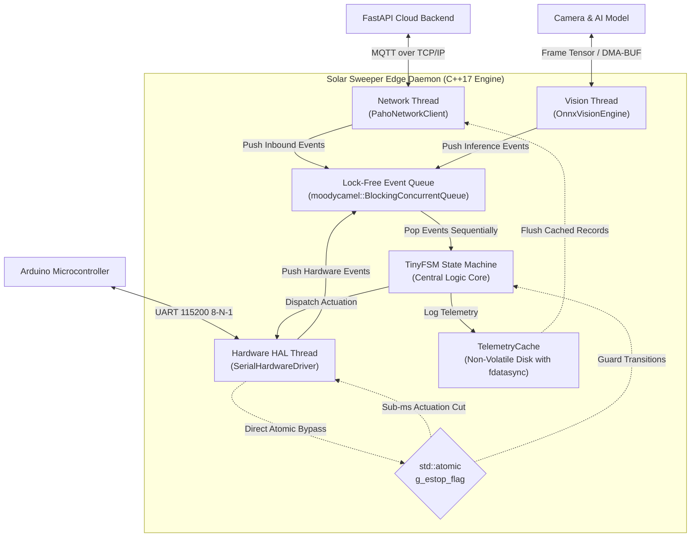
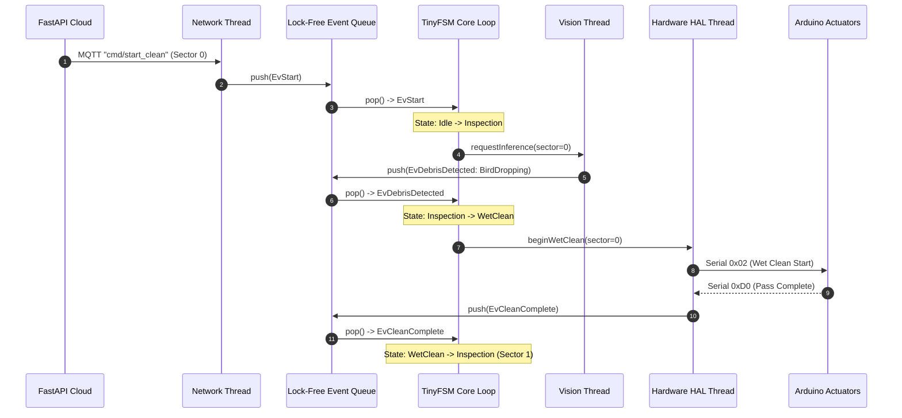
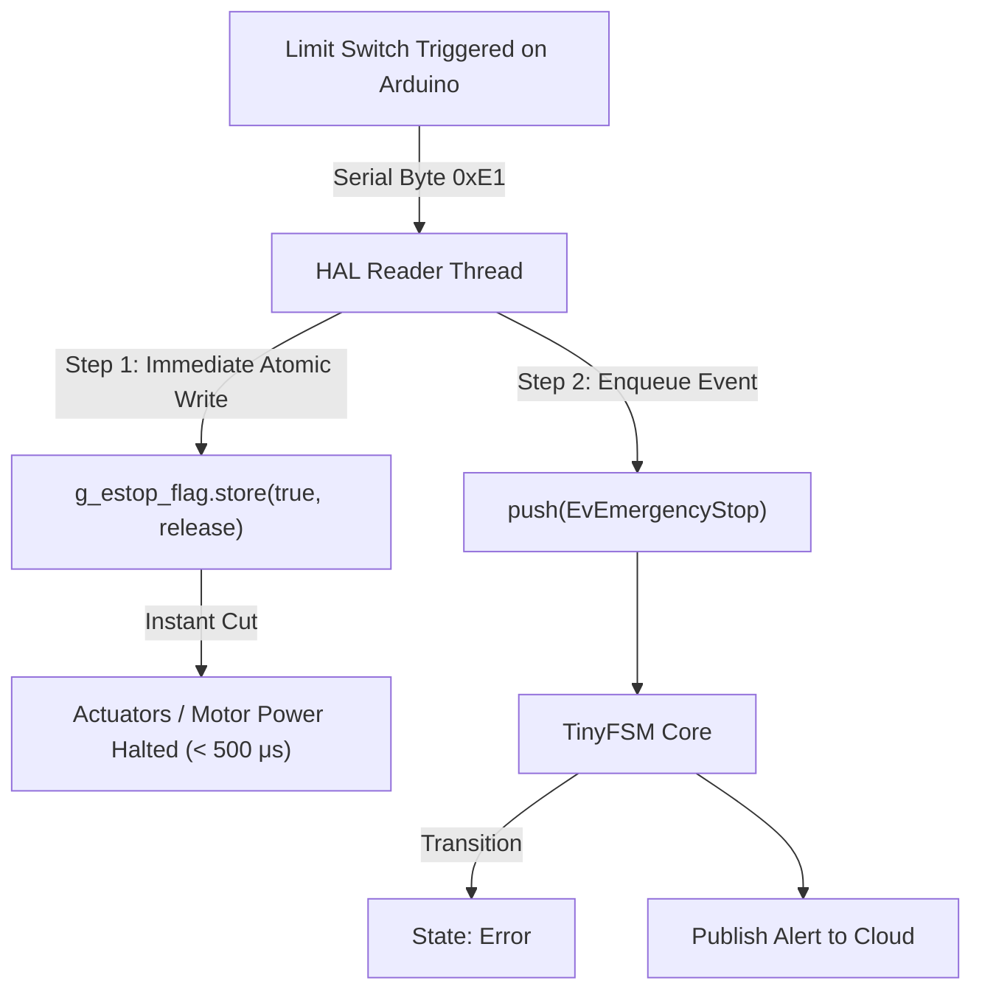

# System Architecture & Concurrency Model

## 1. Executive Summary

The **Solar Sweeper Edge Daemon** is the central embedded compute engine running on a Raspberry Pi (or similar Linux SBC) aboard an autonomous solar panel cleaning gantry. It acts as the deterministic bridge between three distinct domains:

1. **The Cloud (FastAPI Backend):** Sends high-level cleaning missions and receives telemetry over MQTT.
2. **The Vision AI Engine (ONNX Runtime / OpenCV):** Inspects panel sectors and classifies debris.
3. **The Physical Actuators (Arduino Microcontroller):** Controls brush motors, water solenoid valves, linear gantry motion, and mechanical limit switches over UART/Serial.



---

## 2. Multi-Threaded Concurrency Model

In traditional embedded systems, monolithic single-threaded loops (`while(1)` or Arduino `loop()`) frequently suffer from blocking latency. For example, if the CPU is busy running an image classification model or waiting on a slow Wi-Fi packet, a mechanical limit switch hit could be missed, leading to physical equipment damage.

The Edge Daemon decouples all asynchronous operations across **isolated worker threads** communicating via a **Lock-Free Multiple-Producer Single-Consumer (MPSC) Event Queue**:



### Thread Responsibilities

| Thread | Role | Blocking Behavior | Communication Mechanism |
|---|---|---|---|
| **Main / Event Loop Thread** | Runs TinyFSM state transitions and dispatches actions. | Non-blocking (pops from event queue with 50ms timeout). | Reads from `EventQueue`. |
| **Hardware HAL Reader Thread** | Listens on the POSIX serial port descriptor using `select()`. | Non-blocking with timeout. | Flips `g_estop_flag` and pushes to `EventQueue`. |
| **Network Thread** | Manages MQTT broker connection and telemetry flush. | Asynchronous event loop. | Pushes commands to `EventQueue`, reads from `TelemetryCache`. |
| **Vision Thread** | Captures camera frames and runs ONNX inference. | Offloads computation asynchronously. | Pushes inference results to `EventQueue`. |
| **Interactive Console Thread (Optional)** | Reads stdin for live developer commands during testbench mode. | Blocks on `std::getline(cin)`. | Pushes debug events to `EventQueue`. |

---

## 3. Sub-Millisecond Atomic Hardware Safety

A critical requirement of the system is that **hardware safety overrides software state**.

If an actuator hits a physical limit switch or detects a motor stall, the system cannot afford to wait for the State Machine to finish processing other queued events before cutting power.



1. **Step 1 (Sub-millisecond Hardware Cut):** The HAL serial reader receives `0xE1` / `0xE2` and immediately executes `g_estop_flag.store(true, std::memory_order_release)`. Any subsequent actuation request is dropped instantly in hardware without waiting for queue processing.
2. **Step 2 (State Machine Synchronization):** The HAL thread pushes `EvEmergencyStop` to the queue. When the FSM pops it, it formally transitions to `Error`, halts all subsystems, and notifies the cloud.
3. **Step 3 (Race Condition Immunity):** Even if an `EvStart` or `EvCleanComplete` event was already queued *before* the E-Stop was popped, the FSM checks `IsEstopActive()` before executing the transition, safely discarding stale events.

---

## 4. Architectural Boundaries & Data Flow

```
[ External Cloud ] <--- MQTT (JSON) ---> [ Network Layer ]
                                              |
                                     (EvStart, EvAbort)
                                              v
[ Arduino Actuators ] <-- Serial (Bytes) -> [ Hardware HAL ] --> [ Lock-Free Queue ] --> [ TinyFSM Engine ]
                                              ^                         ^
                                              |                         |
[ Camera / Model ] <--- Tensors ---------> [ Vision Layer ] -----------+
```

Every boundary is governed by an abstract C++ interface (`INetworkClient`, `IHardwareDriver`, `IVisionEngine`). This allows the daemon to boot and run in **100% mock mode on a developer's laptop**, in **hardware-in-the-loop (HIL) mode on a desk testbench**, or in **full production mode aboard the physical gantry** simply by changing flags in `config/daemon.config.json`.
