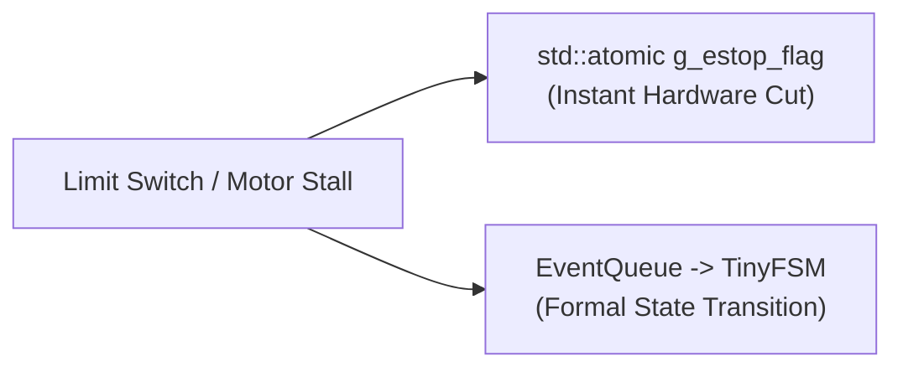

# Architectural Decisions & Engineering Rationale (ADRs)

This document records the critical architectural choices, trade-offs evaluated, and engineering rationale behind the design of the Solar Sweeper Edge Daemon.

---

## 📑 Index of Architectural Decision Records

* [ADR-01: Choice of Language — Modern C++ (C++17)](#adr-01-choice-of-language--modern-c-c17)
* [ADR-02: State Machine Architecture — TinyFSM vs Alternatives](#adr-02-state-machine-architecture--tinyfsm-vs-alternatives)
* [ADR-03: Concurrency Engine — Lock-Free MPSC Queue vs Mutex](#adr-03-concurrency-engine--lock-free-mpsc-queue-vs-mutex)
* [ADR-04: Safety Architecture — Atomic Flag Bypass vs Pure Event Queue](#adr-04-safety-architecture--atomic-flag-bypass-vs-pure-event-queue)
* [ADR-05: Contract Malleability — Config-Driven Tables & RFC 6901 JSON Pointers](#adr-05-contract-malleability--config-driven-tables--rfc-6901-json-pointers)
* [ADR-06: Storage Durability — POSIX `fdatasync()` & Cloud Sequence Tracking](#adr-06-storage-durability--posix-fdatasync--cloud-sequence-tracking)
* [ADR-07: Testing Strategy — Virtual PTY Hardware Loopbacks & Catch2 v3](#adr-07-testing-strategy--virtual-pty-hardware-loopbacks--catch2-v3)

---

## ADR-01: Choice of Language — Modern C++ (C++17)

### Context
The Edge Daemon runs on an embedded Linux SBC (Raspberry Pi 4/5) with shared CPU and RAM resources alongside an ONNX Runtime neural network engine and high-framerate camera stream.

### Decision
Use **Modern C++ (C++17)** as the core implementation language.

### Rationale & Alternatives Evaluated
* **Why not Python?** Python's Global Interpreter Lock (GIL), garbage collection pauses (stop-the-world spikes), and high memory footprint create non-deterministic latencies that can miss hardware interrupt deadlines.
* **Why not Rust?** While Rust offers excellent safety, C++17 provides seamless zero-overhead interoperability with OpenCV C++ APIs, V4L2 kernel headers, POSIX termios, and ONNX Runtime C++ bindings without complex FFI wrappers.
* **Why C++17 over C++98/C++03?** C++17 brings `std::variant`, `std::optional`, `std::string_view`, structured bindings, and atomic memory fences (`std::memory_order_release` / `acquire`), enabling type-safe, zero-allocation data structures.

---

## ADR-02: State Machine Architecture — TinyFSM vs Alternatives

### Context
The robot transitions through distinct operational phases (`Boot_Init`, `Idle`, `Inspection`, `DryClean`, `WetClean`, `Offline_Idle`, `Error`, `Hardware_Fault`). We required a deterministic state engine.

### Decision
Adopt **TinyFSM**, a template-based, header-only C++ finite state machine library.

### Rationale & Alternatives Evaluated
* **Alternative 1: `switch-case` / `if-else` loops:** Unmaintainable for complex robotics. As states increase, cyclomatic complexity explodes, and state-entry/state-exit cleanup actions become error-prone.
* **Alternative 2: `Boost.MSM` / `Boost.Statechart`:** Powerful but causes massive template bloat, enormous compilation times (minutes on SBCs), and heavy binary size.
* **Why TinyFSM Wins:**
  1. **Zero Dynamic Allocation:** State instances are compile-time singletons; transitions execute without heap allocation (`malloc`/`new`).
  2. **Type-Safe Dispatch:** Dispatch is resolved via static polymorphism and `std::visit` on `std::variant<Events...>`.
  3. **Explicit Entry/Exit Hooks:** Guarantees that actuators are parked via `exit()` hooks regardless of how a state is departed.

---

## ADR-03: Concurrency Engine — Lock-Free MPSC Queue vs Mutex

### Context
Multiple asynchronous producers (Network thread, Vision thread, Hardware reader thread, and developer CLI console) push events into the State Machine thread concurrently.

### Decision
Use `moodycamel::BlockingConcurrentQueue` as a **Lock-Free Multiple-Producer Single-Consumer (MPSC) Queue**.

### Rationale & Alternatives Evaluated
* **Why not `std::mutex` + `std::condition_variable`?**
  * Mutex contention introduces unpredictable thread preemption.
  * In embedded Linux with real-time threads, mutexes can lead to **priority inversion** (a low-priority logging thread holding a mutex that a high-priority safety thread needs).
* **Why moodycamel wins:**
  * Uses lock-free atomic circular rings and hazard pointers.
  * Enqueue/dequeue latency is measured in nanoseconds.
  * Producers never block one another when pushing events simultaneously.

---

## ADR-04: Safety Architecture — Atomic Flag Bypass vs Pure Event Queue

### Context
When an emergency stop occurs (e.g. limit switch hit or operator abort), actuators must halt in sub-milliseconds.

### Decision
Implement a **Dual-Channel Safety Architecture**:
1. **Channel 1 (Immediate Hardware Cut):** `std::atomic<bool> g_estop_flag` set directly by the reader thread.
2. **Channel 2 (Logical State Sync):** `EvEmergencyStop` event pushed to the queue.

### Rationale
* If an emergency stop only pushed an event into the queue, and the queue already had 10 items queued ahead of it, the robot would continue moving until all 10 items were popped!
* By flipping `g_estop_flag` **first**, all subsequent actuation calls (`beginDryClean`, `beginWetClean`, `transit<Inspection>`) are dropped immediately upon reading the atomic flag.

---

## ADR-05: Contract Malleability — Config-Driven Tables & RFC 6901 JSON Pointers

### Context
In multidisciplinary capstone projects, external teammates (Arduino hardware engineers and FastAPI backend developers) frequently iterate on serial byte codes and JSON payload field names.

### Decision
Implement data-driven protocol lookup tables and **RFC 6901 JSON pointer fallback extraction** in `JsonHelper.h` and `Config.cpp`.

### Rationale
* **Serial Opcode Independence:** Command bytes (`dry_clean: "0x01"`) and interrupt codes (`"0xE1": { "event": "estop" }`) are loaded from `daemon.config.json`. Changing an opcode requires editing one JSON string, not recompiling C++ code.
* **Tolerant Reader Pattern:** Cloud command decoders evaluate fallback chains (e.g., `["/sector_id", "/sectorId", "/sector", "/payload/sector"]`). Backend naming modifications do not break the edge daemon.

---

## ADR-06: Storage Durability — POSIX `fdatasync()` & Cloud Sequence Tracking

### Context
When Wi-Fi drops, telemetry must be cached locally. Embedded Raspberry Pi devices are susceptible to sudden power disconnects (battery failure or cable pulls).

### Decision
Use append-only `.jsonl` disk storage coupled with **POSIX `fdatasync()`** and **monotonic sequence ID stamping**.

### Rationale
* **Why not plain `ofstream.flush()`?** User-space flush only transfers bytes to the Linux kernel page cache. If power is pulled 2 seconds later, uncommitted RAM pages are lost.
* **Why `fdatasync()`?** Forces the storage controller to commit bytes to physical flash before returning, guaranteeing durability across hard power loss.
* **Why Monotonic Sequence IDs?** Stamping each record with `{device_id}-{timestamp_ms}-{seq_id}` enables the cloud backend to deduplicate messages idempotently if the daemon retransmits records upon reconnect.

---

## ADR-07: Testing Strategy — Virtual PTY Hardware Loopbacks & Catch2 v3

### Context
Developers need to test the entire system on laptops and CI runners without physical Arduino boards or robots connected.

### Decision
Use **Catch2 v3** paired with **Linux Pseudo-Terminals (`openpty` / `posix_openpt`)** and deterministic Mock interfaces.

### Rationale
* `SerialHardwareDriver` can open a virtual PTY slave descriptor (`/dev/pts/X`) as if it were a physical `/dev/ttyACM0` port.
* Automated unit tests can write `0xE1` into the master descriptor and assert that `g_estop_flag` latches true and `EvEmergencyStop` arrives in the queue with microsecond accuracy.
* Enables 100% automated regression testing without manual hardware manipulation.
