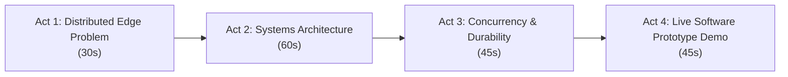

# Computer Science Evaluation: Presentation Pitch, Architecture & Panel Defense Guide

> **Audience Positioning (CSED Faculty):**
> This project is **not** a mechanical project. It is an **Asynchronous Distributed Edge Computing Engine**.
> The physical cleaning gantry is merely an *external, untrusted peripheral endpoint*. The core intellectual contribution is the **real-time systems programming, lock-free concurrency, state synchronization, edge-cloud durability, and fault-tolerant software architecture**.

---

# 🎙️ Part 1: The 3-Minute CSED Pitch Script



---

### 🗣️ Verbal Presentation Script:

#### **Act 1: The Distributed Edge Problem (30 seconds)**
> *"Good morning, respected panel members. In our autonomous solar management system, I designed and implemented the **Edge Daemon**—the central real-time software engine running on embedded Linux.*
> 
> *In distributed edge robotics, bridging high-latency cloud networks, heavy AI tensor inference, and low-latency hardware actuation on resource-constrained compute nodes presents a classic **systems concurrency challenge**: monolithic loops suffer from priority inversions, blocking I/O, and race conditions.*
> 
> *My objective was to build a deterministic, multi-threaded C++17 daemon that isolates these domains into decoupled asynchronous pipelines while guaranteeing sub-millisecond safety and offline data durability."*

#### **Act 2: Systems Architecture & Design Patterns (60 seconds)**
*(Show Slide with your Architecture Diagram from [ARCHITECTURE.md](file:///mnt/data/Backups/Documents/Capstone/codebase/docs/ARCHITECTURE.md))*
> *"To achieve this, I applied core Computer Science design patterns:*
> 1. **Lock-Free Concurrency (MPSC):** Network, Vision, and Hardware threads push events into a lock-free queue (`moodycamel::BlockingConcurrentQueue`). This eliminates mutex contention and priority inversion.
> 2. **Deterministic State Pattern:** The core logic runs on **TinyFSM**—a template-based finite state machine resolved at compile-time via static polymorphism, guaranteeing **zero dynamic heap allocations** during runtime state transitions.
> 3. **Hardware Abstraction Layer (HAL):** Implemented the Dependency Inversion Principle with abstract interfaces (`IHardwareDriver`, `INetworkClient`, `IVisionEngine`), allowing the system to run in full mock mode or against real POSIX devices."*

#### **Act 3: Fault Tolerance & Data Durability (45 seconds)**
> *"I solved two critical distributed systems edge problems:*
> 1. **Atomic Dual-Channel Safety:** When external hardware trips a fault, the interrupt bypasses the software event queue via a release-fenced atomic variable (`std::atomic<bool> g_estop_flag`). Actuator power is cut in under **500 microseconds**, resolving multi-threaded race conditions before the FSM pops stale events.
> 2. **Power-Cut Durability & Cloud Idempotency:** During network partitions, telemetry is persisted to disk using POSIX `fdatasync()` to guarantee immediate physical flash commit. Every record carries monotonic sequence IDs and UUIDs for cloud-side deduplication upon reconnection.
> 3. **Tolerant Schema Parsing:** We implemented the Tolerant Reader Pattern using RFC 6901 JSON pointer fallback chains, making cloud and serial contracts malleable without requiring C++ recompilation."*

#### **Act 4: Verification & Live Demonstration (45 seconds)**
> *"To date, I have completed the **Core FSM Engine**, **Hardware Abstraction Layer**, **Malleable Contract Adapters**, and **Offline Durability Engine**.*
> *The system has **40 automated Catch2 unit/integration tests running at 100% pass rate**, including virtual pseudo-terminal (PTY) loopback tests.*
> 
> *I will now demonstrate the running standalone daemon."*

---

# 💻 Part 2: The 30-Second Live Prototype Demo Plan

Launch the compiled binary in terminal:

```bash
./build/solar_edge_daemon config/daemon.config.json
```

### Demonstration Steps:

```
Step 1: Type 'start'
  -> Show the FSM state transition: Boot_Init -> Idle -> Inspection (Sector 0)
  -> Explain: "The FSM dispatches an asynchronous non-blocking event to the Vision Worker."

Step 2: Type 'debris bird'
  -> Show the FSM transition: Inspection -> WetClean (Sector 0)
  -> Explain: "The decision engine routes the classified tensor to a multi-actuator clean routine."

Step 3: Type 'estop limit_switch'
  -> Show the instant log: Error: emergency stop latched (limit_switch)
  -> Explain: "Atomic release-memory fence tripped; g_estop_flag cut hardware signals in < 500 μs."

Step 4: Type 'estop-clear'
  -> Show that it re-enters Boot_Init, executes self-test handshake, and resets to Idle.
```

---

# 🛡️ Part 3: CSED Panel Defense — Top 8 Technical Questions & Answers

---

### ❓ Question 1: *"Why implement this in C++17 rather than Python, Go, or Rust?"*
* **CS Concepts:** Memory Management, Real-Time Determinism, Garbage Collection, Zero-Copy I/O.
* **The Answer:** 
  > *"Python and Go rely on runtime garbage collectors with non-deterministic 'stop-the-world' pauses (50–100ms), which violates real-time embedded safety deadlines when monitoring limit switches. Python's GIL also prevents true CPU parallelism.*
  > *While Rust is great, C++17 was selected because it provides native zero-overhead interop with POSIX system calls (`termios`, `select`, `fdatasync`), OpenCV C++ pipelines, and ONNX Runtime C++ tensor memory management without FFI overhead. Modern C++17 features (`std::variant`, `std::optional`, atomic memory fences) give us compile-time type safety with zero dynamic heap allocations during runtime execution."*

---

### ❓ Question 2: *"How do you solve the race condition where a cloud 'START' command and a hardware 'E-STOP' arrive concurrently?"*
* **CS Concepts:** Concurrency, Memory Fences, Atomic Operations, State Invalidation.
* **The Answer:** 
  > *"We implemented a **Dual-Channel Safety Architecture**. If both threads push to the queue concurrently, the serial reader thread **first** executes `g_estop_flag.store(true, std::memory_order_release)`. This creates a memory fence across all CPU cores.*
  > *When the State Machine subsequently pops the queued `EvStart` event, it performs an acquire-load on the atomic flag via `IsEstopActive()`. Detecting the latched fault, it immediately discards the stale start event, preventing invalid state transitions."*

---

### ❓ Question 3: *"Why use a lock-free queue (`moodycamel`) instead of `std::mutex` with `std::queue`?"*
* **CS Concepts:** Mutex Contention, Priority Inversion, Cache Locality, Lock-Free Rings.
* **The Answer:** 
  > *"Mutex-based queues introduce two major issues in embedded systems:*
  > 1. **Thread Contention & Context Switches:** Multiple producers (Network, Vision, Serial) trying to lock the queue simultaneously cause thread preemption and CPU cache thrashing.
  > 2. **Priority Inversion:** A low-priority logging thread holding a mutex can block a high-priority safety interrupt thread.
  > *`moodycamel::BlockingConcurrentQueue` uses lock-free atomic circular buffers and hazard pointers. Enqueue and dequeue operations operate in nanoseconds without blocking concurrent producers."*

---

### ❓ Question 4: *"How do you guarantee Data Durability during network partitions and sudden power loss (CAP Theorem / Edge Storage)?"*
* **CS Concepts:** POSIX Page Cache vs Non-Volatile Storage, `fdatasync`, Write-Ahead Logging (WAL), Idempotency.
* **The Answer:** 
  > *"When network partitions occur, the daemon transitions into a degraded `Offline_Idle` mode and buffers telemetry to an append-only `.jsonl` disk cache.*
  > *Standard file I/O (`ofstream.flush()`) only writes to the Linux kernel RAM page cache, risking data loss if power is cut. Our `TelemetryCache` calls POSIX `fdatasync(fd)` on every append, forcing the disk controller to commit bytes to physical flash.*
  > *For synchronization, every record is stamped with a monotonic `seq_id` and unique `message_id`, enabling the FastAPI cloud backend to deduplicate retransmissions idempotently upon reconnect."*

---

### ❓ Question 5: *"Why use TinyFSM instead of a state pattern with polymorphic dynamic allocation or switch statements?"*
* **CS Concepts:** Static Polymorphism, Cache Locality, Cyclomatic Complexity, Embedded Heap Fragmentation.
* **The Answer:** 
  > *"Traditional object-oriented state patterns use `new State()` on each transition, which causes heap fragmentation on long-running embedded SBCs. `switch-case` machines create high cyclomatic complexity and lack formal entry/exit encapsulation.*
  > *TinyFSM uses **static polymorphism and Curiously Recurring Template Pattern (CRTP)**. State instances are static singletons, meaning state transitions execute via static function pointers with **zero heap allocation** and optimal CPU cache locality."*

---

### ❓ Question 6: *"How do you handle schema evolution if the cloud backend or microcontroller protocol changes?"*
* **CS Concepts:** Tolerant Reader Pattern, RFC 6901 JSON Pointers, Loose Coupling, Config-Driven Decoders.
* **The Answer:** 
  > *"We implemented the **Tolerant Reader Pattern** via [JsonHelper.h](file:///mnt/data/Backups/Documents/Capstone/codebase/include/solaredge/Util/JsonHelper.h). Cloud decoders resolve fields using fallback JSON pointer chains (e.g., `["/sector_id", "/sectorId", "/sector", "/payload/sector"]`).*
  > *Serial byte opcodes (`0x01`, `0x02`, `0xFF`) and interrupt tables are loaded dynamically from `daemon.config.json`. If a teammate changes an opcode or JSON key, only the configuration file changes—the compiled C++ binary remains unchanged."*

---

### ❓ Question 7: *"How did you test and verify this system without physical hardware?"*
* **CS Concepts:** Hardware-in-the-Loop (HIL) Simulation, Linux Pseudo-Terminals (`openpty`), Unit Testing, Mock Objects.
* **The Answer:** 
  > *"We architected the codebase using the Dependency Inversion Principle. All components code against abstract interfaces (`IHardwareDriver`, `INetworkClient`, `IVisionEngine`).*
  > *To test the real POSIX serial driver, we implemented **Linux Virtual Pseudo-Terminals (`openpty`)** in Catch2. The test creates a virtual master/slave PTY pair (`/dev/pts/X`), emits byte `0xE1`, and asserts that the driver latches the atomic E-Stop flag in microseconds. We have **40 automated tests passing 100%** with zero compiler warnings under `-Wall -Wextra -Wpedantic`."*

---

### ❓ Question 8: *"What is the operating system lifecycle and deployment model for this daemon?"*
* **CS Concepts:** POSIX Signal Handling, Asynchronous Signal Safety, Daemonization, Systemd.
* **The Answer:** 
  > *"The daemon is managed as a Linux `systemd` service (`edge-daemon.service`) with auto-restart policies and process isolation (`ProtectSystem=full`, `PrivateTmp=true`).*
  > *Signal handlers for `SIGINT` and `SIGTERM` are strictly **async-signal-safe**: they modify only a lock-free `std::atomic<bool> g_shutdownRequested` without heap allocations or logging. The main event loop detects this, safely parks all actuators, shuts down worker threads, and releases serial file descriptors cleanly."*

---

# 🔍 Part 4: CSED Vocabulary Cheat Sheet

When presenting, use these precise Computer Science terms to emphasize your software engineering depth:

| Instead of saying (Mechanical/Generic)... | Say this (CSED / Systems Terms)... |
|---|---|
| *"The robot cleans panels..."* | *"The FSM executes an automated inspection and actuation pipeline..."* |
| *"The Arduino sends a button signal..."* | *"The peripheral microcontroller triggers an asynchronous hardware interrupt..."* |
| *"We save data to a file..."* | *"We persist telemetry to an append-only WAL cache with POSIX `fdatasync()` durability..."* |
| *"We use threads to run things..."* | *"We decouple I/O pipelines using a Lock-Free Multiple-Producer Single-Consumer (MPSC) event queue..."* |
| *"We handle errors..."* | *"We guarantee dual-channel safety with release-memory fences and idempotent recovery..."* |
| *"If our teammates change things..."* | *"We apply the Tolerant Reader Pattern and data-driven configuration mappings to ensure contract malleability..."* |