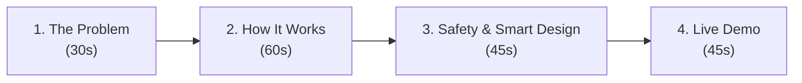

# Panel Presentation & Defense Guide (Clear & Conversational)

> **The Core Idea:**
> We are building the **Central Brain (Edge Daemon)** on a Raspberry Pi.
> The physical cleaning machine is just an external tool that our software controls safely and reliably.

---

# 🎙️ Part 1: Your 3-Minute Presentation Pitch

Speak naturally and conversationally. You don't need heavy jargon—just clear logic.



---

### 🗣️ What to Say (Verbal Script):

#### **1. The Problem (30 seconds)**
> *"Good morning. I am responsible for the **Edge Daemon**—the central software running on a Raspberry Pi that controls our automated solar cleaner.*
> 
> *Here is the core software challenge: on a robot like this, you have three very different jobs:*
> 1. *Talking to the cloud over Wi-Fi,*
> 2. *Running heavy AI vision models,*
> 3. *Sending fast commands to motors and watching for safety switches.*
> 
> *If you try to do all three in a simple single loop, the moment the camera processes an image or Wi-Fi lags, **the entire program freezes**. If the machine hits a physical barrier while frozen, it will damage itself.*
> 
> *My job was to build a multi-threaded C++ system where these three jobs run independently and never block each other."*

#### **2. How It Works (60 seconds)**
*(Show Slide with your Architecture Diagram from [ARCHITECTURE.md](file:///mnt/data/Backups/Documents/Capstone/codebase/docs/ARCHITECTURE.md))*
> *"To solve this, I split the software into **three independent worker threads** and a **central State Machine** connected by a fast event queue:*
> 
> * *The **Network Worker** listens to cloud commands from FastAPI.*
> * *The **Vision Worker** processes camera frames and detects debris.*
> * *The **Hardware Worker** talks to the Arduino over a serial connection.*
> 
> *When any worker has an update, it drops a message into our central **Event Queue**. The State Machine processes these messages one by one to decide what the robot does next—like moving from `Inspection` to `DryClean` or `WetClean`."*

#### **3. Safety & Flexibility (45 seconds)**
> *"There are three key design decisions I want to highlight:*
> 
> 1. **Instant Emergency Stop:** *If a physical limit switch is hit, it doesn't wait in line in the event queue. It flips an instant safety flag in memory that cuts motor power in **less than a millisecond**.*
> 2. **Flexible Contracts:** *Nothing is hardcoded. All Arduino command bytes and cloud topic names live in a JSON config file. If my teammates change a command byte or a JSON field name tomorrow, **we just edit one config line without changing or recompiling any code**.*
> 3. **Zero Data Loss:** *If Wi-Fi drops, telemetry is saved directly to disk. Even if someone pulls the power plug, the data is safely written to flash memory and sent when the internet comes back.*"

#### **4. What is Done & Live Demo (45 seconds)**
> *"To date, I have completed the **Core State Machine**, the **Serial Hardware Driver**, the **Configurable Adapters**, and the **Offline Disk Cache**.*
> *Everything is verified with **40 automated tests passing at 100%**.*
> 
> *Let me quickly show you how it works in action."*

---

# 💻 Part 2: Quick 30-Second Live Demo

Run the application in your terminal:

```bash
./build/solar_edge_daemon config/daemon.config.json
```

### What to type and explain:

```text
1. Type: 'start'
   -> Explain: "The robot starts its mission and enters 'Inspection' mode on Sector 0."

2. Type: 'debris bird'
   -> Explain: "Vision detects bird droppings, so the robot automatically switches to 'Wet Clean' (turning on water and brushes)."

3. Type: 'estop limit_switch'
   -> Explain: "A limit switch was struck. The safety flag tripped immediately, killing actuator power and moving to 'Error' mode."

4. Type: 'estop-clear'
   -> Explain: "The error is cleared, the system runs its self-test, and safely returns to Idle."
```

---

# 🛡️ Part 3: Questions the Panel Might Ask (Simple & Clear Answers)

---

### ❓ Q1: *"Why did you use C++ instead of Python?"*
* **Simple Answer:** 
  > *"Python uses an automatic memory cleaner (garbage collector) that can randomly pause the program for 50 to 100 milliseconds. If the robot hits a limit switch during that pause, it wouldn't react in time. C++ gives us guaranteed, microsecond-level reaction time and full control over memory."*

---

### ❓ Q2: *"What happens if a 'START' command and an 'EMERGENCY STOP' arrive at the exact same time?"*
* **Simple Answer:** 
  > *"Safety always wins. The emergency stop flips an immediate safety flag in memory before doing anything else. When the State Machine reads the 'START' command a moment later, it checks the safety flag first, sees that there is a fault, and throws away the start command."*

---

### ❓ Q3: *"What if the internet cuts out while the robot is cleaning?"*
* **Simple Answer:** 
  > *"The robot won't stop in the middle of a panel—that would leave wet sludge and dirt behind. It finishes the current cleaning pass safely, moves to an offline standby mode, and saves all reports to a file on disk. Once Wi-Fi comes back, it automatically uploads the saved reports to the cloud."*

---

### ❓ Q4: *"What if someone pulls the battery or power cord? Won't you lose the cached data?"*
* **Simple Answer:** 
  > *"No. Normally, operating systems keep file writes in temporary RAM for a few seconds before writing to the SD card. We use a system call called `fdatasync` that forces the data onto physical flash memory immediately after writing. So even if the plug is pulled instantly, the data is safe."*

---

### ❓ Q5: *"Why did you use an event queue instead of just locking data with mutexes?"*
* **Simple Answer:** 
  > *"Mutexes make threads wait on each other. If the logging thread or network thread locks a mutex, a high-priority safety check might get delayed. Our lock-free queue lets all workers drop messages in parallel without ever waiting on each other."*

---

### ❓ Q6: *"What if your teammate changes an Arduino command byte or a cloud JSON field?"*
* **Simple Answer:** 
  > *"Nothing breaks. We don't hardcode byte values or exact JSON keys in C++. They are mapped in our `daemon.config.json` file. If my teammate changes a key from `sector_id` to `target_sector`, our parser checks a list of fallback names automatically without needing any code changes."*

---

### ❓ Q7: *"How did you test this without having the full physical robot built?"*
* **Simple Answer:** 
  > *"We built the software with clean interfaces so we can swap between real hardware and simulation. In our automated test suite, we created a virtual serial connection inside Linux to send fake sensor signals and test limit switches. We have 40 automated tests that test every transition, race condition, and error state."*

---

### ❓ Q8: *"What is a State Machine and why use it instead of `if/else` statements?"*
* **Simple Answer:** 
  > *"If you use nested `if/else` statements, the code quickly becomes messy and it is easy to forget safety cleanup (like turning off the water pump when stopping). A State Machine makes sure the robot can only be in one clear state at a time (like `Idle`, `Inspection`, or `WetClean`) and guarantees that actuators are always stopped whenever leaving a state."*