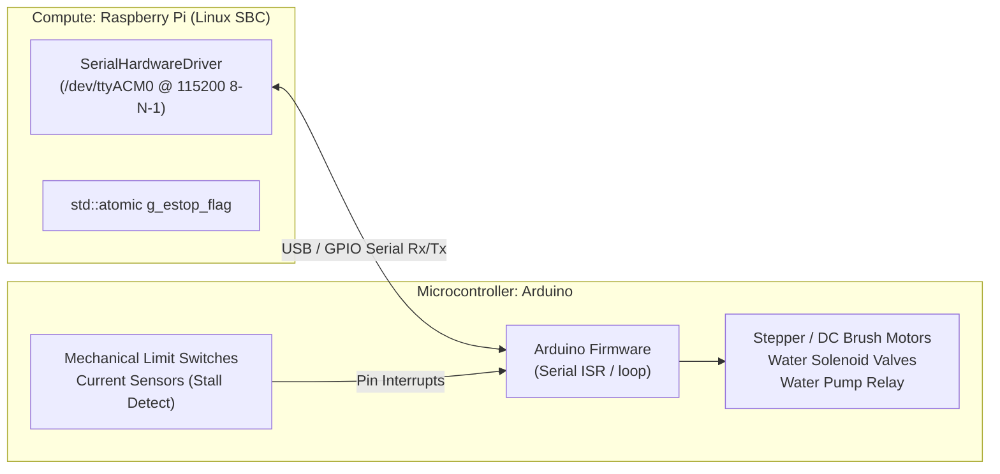

# Hardware Abstraction Layer & Safety Architecture

## 1. Hardware Overview & Physical Wiring

The **Solar Sweeper Edge Daemon** communicates with an Arduino microcontroller (Uno, Mega, Nano, or STM32) over a bidirectional **UART / USB-Serial link**.



### Physical Connection Specifications
* **Port:** `/dev/ttyACM0` or `/dev/ttyUSB0` (configured via `serial.device_path`)
* **Baud Rate:** 115200 bps (configurable: 9600 to 230400)
* **Framing:** 8 Data Bits, No Parity, 1 Stop Bit (8-N-1)
* **Flow Control:** None (No RTS/CTS, No XON/XOFF)

---

## 2. POSIX Serial Driver Implementation

The HAL is implemented in [SerialHardwareDriver.cpp](file:///mnt/data/Backups/Documents/Capstone/codebase/src/Hardware/SerialHardwareDriver.cpp) using direct Linux POSIX system calls (`termios.h`, `fcntl.h`, `unistd.h`):

1. **Non-Blocking Descriptor with Timeout:**
   * Opened with `O_RDWR | O_NOCTTY | O_NONBLOCK`.
   * Configured via `tcgetattr()` and `tcsetattr()` in raw mode (`~ICANON`, `~ECHO`, `~ISIG`, `~OPOST`).
2. **Dedicated Background Reader Thread:**
   * Uses `select()` with a 100ms timeout to monitor incoming bytes without blocking other threads.
   * Feeds bytes through the configurable interrupt lookup table (`config.serial().interrupts`).

---

## 3. Byte Protocol & Malleable Opcode Map

All command and interrupt byte definitions are loaded dynamically from `config/daemon.config.json`. Changing byte assignments does not require code recompilation.

### Outbound Commands (Edge Daemon $\to$ Arduino)

| Logical Command | Default Byte | Description |
|---|:---:|---|
| **`DRY_CLEAN`** | `0x01` | Commands the Arduino to start the dry roller-brush motor and advance linear travel for the sector. |
| **`WET_CLEAN`** | `0x02` | Commands the Arduino to open the water solenoid valve, activate the pump, and start the roller brush. |
| **`EMERGENCY_HALT`** | `0xFF` | Hardware kill command. Arduino must immediately kill power to all motor drivers and close valves. |
| **`PING`** | `0x00` | Boot self-test heartbeat check. |

### Inbound Interrupts & Signals (Arduino $\to$ Edge Daemon)

| Byte Code | Type | Logical Signal | Daemon Action |
|:---:|:---:|---|---|
| **`0xE1`** | **Emergency Interrupt** | `LIMIT_SWITCH_HIT` | Immediately sets `g_estop_flag = true`, halts gantry, enters `Error`. |
| **`0xE2`** | **Emergency Interrupt** | `MOTOR_STALL` | Immediately sets `g_estop_flag = true`, halts gantry, enters `Error`. |
| **`0xD0`** | Success Signal | `ACTION_COMPLETE` | Dispatches `EvCleanComplete`, advancing FSM to the next sector. |
| **`0xA0`** | Handshake Response | `ACK_PING` | Confirms Arduino boot self-test readiness (`EvBootHardwareReady`). |
| **`0xA1` / `0xA2`** | ACK | `ACK_DRY` / `ACK_WET` | Logs command receipt. |
| **`0xAF`** | ACK | `ACK_HALT` | Confirms emergency halt executed. |

---

## 4. Sub-Millisecond Dual-Channel Safety Architecture

### Why Software-Only Queueing is Unsafe for Robotics
In standard message-driven systems, placing a safety stop at the end of a queue introduces latency:
$$\text{Latency} = N_{\text{queued events}} \times \text{Processing Time per Event}$$
If the queue holds multiple heavy events, actuators could continue moving for tens or hundreds of milliseconds after a limit switch is physically struck.

### The Dual-Channel Solution
```cpp
// In SerialHardwareDriver::HandleIncomingByte:
if (def.eventType == "estop") {
    // Channel 1: Atomic hardware bypass (Sub-millisecond memory fence)
    core::g_estop_flag.store(true, std::memory_order_release);
    
    // Channel 2: Enqueue formal state synchronization
    queue_.push(events::EvEmergencyStop{{}, def.reason});
}
```

* **Memory Semantics:** The release memory order guarantees that the flag update is immediately visible across all CPU cores.
* **Actuator Guard:** Before any actuation instruction is transmitted, the driver checks `if (core::g_estop_flag.load(std::memory_order_acquire)) return;`.
* **State Machine Guard:** The State Machine discards stale `EvStart` or `EvCleanComplete` events if `IsEstopActive()` evaluates to true.

---

## 5. Production Deployment (Systemd Service)

The daemon includes a production systemd unit file at [config/edge-daemon.service](file:///mnt/data/Backups/Documents/Capstone/codebase/config/edge-daemon.service):

```ini
[Unit]
Description=Solar Sweeper Edge Daemon
After=network.target local-fs.target
Wants=network-online.target

[Service]
Type=simple
User=pi
WorkingDirectory=/opt/solar-edge-daemon
ExecStart=/opt/solar-edge-daemon/bin/solar_edge_daemon /etc/solar-edge-daemon/daemon.config.json
Restart=always
RestartSec=3
KillSignal=SIGTERM
TimeoutStopSec=5

[Install]
WantedBy=multi-user.target
```

### Deployment Steps on Raspberry Pi
```bash
# Copy binary and configuration
sudo cp build/solar_edge_daemon /opt/solar-edge-daemon/bin/
sudo cp config/daemon.config.json /etc/solar-edge-daemon/

# Install and enable service
sudo cp config/edge-daemon.service /etc/systemd/system/
sudo systemctl daemon-reload
sudo systemctl enable edge-daemon
sudo systemctl start edge-daemon
```
