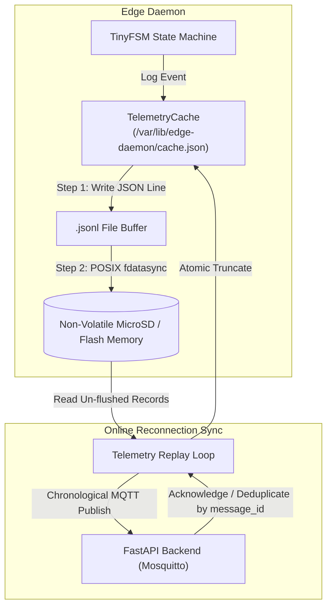

# Offline Resilience & Cloud Telemetry Guide

## 1. Overview & Cloud Integration

The **Solar Sweeper Edge Daemon** communicates with the **FastAPI Cloud Backend** over MQTT (TCP port 1883 or TLS port 8883).

Because outdoor solar farms frequently experience Wi-Fi/cellular dead zones, the daemon incorporates an **industrial-grade Offline Telemetry Cache** that guarantees **zero data loss during network drops and sudden power failures**.



---

## 2. MQTT Topic Namespace & Payloads

Topics are dynamically prefixed using `mqtt.topic_prefix` (default: `solarsweeper/robot01`):

### 1. Inbound Missions & Commands

| Topic | QoS | Payload Example | Description |
|---|:---:|---|---|
| `{prefix}/cmd/start_clean` | 1 | `{"start_sector": 0, "mode": "auto"}` | Starts cleaning pass across all sectors. |
| `{prefix}/cmd/abort` | 2 | `{"reason": "manual_override"}` | Triggers immediate emergency halt. |
| `{prefix}/cmd/reset` | 1 | `{"clear_reason": "inspected"}` | Resets E-Stop and re-runs boot self-test. |

### 2. Outbound Telemetry Streams

| Topic | Trigger / Frequency | Payload Schema Example |
|---|---|---|
| `{prefix}/telemetry/status` | Every 5s / on state change | `{"state": "Inspection", "current_sector": 2, "uptime_sec": 120}` |
| `{prefix}/telemetry/clean_result` | Immediate upon sector completion | `{"sector_id": 2, "debris_type": "bird_dropping", "action_taken": "wet_clean", "success": true}` |
| `{prefix}/telemetry/alert` | Immediate on fault / E-stop | `{"alert_type": "EMERGENCY_STOP", "reason": "limit_switch_hit", "severity": "CRITICAL"}` |

---

## 3. Tolerant Reading & RFC 6901 JSON Pointers

External backend APIs frequently iterate on field naming conventions. To prevent breaking changes, [JsonHelper.h](file:///mnt/data/Backups/Documents/Capstone/codebase/include/solaredge/Util/JsonHelper.h) implements fallback pointer resolution:

```cpp
// Attempts each path in order; returns default (0) if none match
int sector = JsonHelper::ExtractField<int>(
    payloadJson,
    {"/sector_id", "/sectorId", "/sector", "/payload/sector", "/data/target_sector"},
    0
);
```

**Supported Payload Formats (All parsed transparently):**
```json
// Format A (Snake case)
{ "sector_id": 3 }

// Format B (CamelCase)
{ "sectorId": 3 }

// Format C (Nested object)
{ "data": { "target_sector": 3 } }
```

---

## 4. Power-Cut Durability (The `fdatasync` Guarantee)

### The Problem with Standard File I/O
On embedded Linux (Raspberry Pi OS), standard file operations (`std::ofstream << data; stream.flush();`) only move bytes into the **Linux Kernel Page Cache (RAM)**. The kernel flushes dirty pages to the physical MicroSD card periodically (every 5 to 30 seconds).

If the robot experiences an unexpected power loss (battery disconnect or voltage brownout) within that 30-second window, **uncommitted telemetry records in RAM are permanently lost**.

### The Solution: POSIX `fdatasync()`
[TelemetryCache.cpp](file:///mnt/data/Backups/Documents/Capstone/codebase/src/Network/TelemetryCache.cpp) invokes `::fdatasync(fd)` on every single write:
```cpp
ssize_t written = ::write(fd, line.data(), line.size());
// Force physical flash commit immediately
::fdatasync(fd);
::close(fd);
```
* **Result:** Bytes are physically written to the non-volatile flash memory cells before the function returns.
* **Durability:** 100% crash-proof and power-loss-proof.

---

## 5. Cloud-Side Idempotency & Deduplication

When network connectivity is restored, the daemon replays cached records in chronological order. To prevent duplicate analytics in FastAPI if a connection drops mid-ACK:

Every cached record is automatically enriched with unique idempotency metadata:

```json
{
  "message_id": "robot01-1771681205000-42",
  "seq_id": 42,
  "device_id": "robot01",
  "timestamp_ms": 1771681205000,
  "state": "Inspection",
  "current_sector": 2
}
```

* `seq_id`: A 64-bit monotonically increasing sequence counter that resumes across daemon reboots.
* `message_id`: A globally unique key (`{device_id}-{timestamp_ms}-{seq_id}`).
* **Cloud Deduplication:** The FastAPI backend indexes telemetry by `message_id`, discarding any duplicate deliveries automatically.
