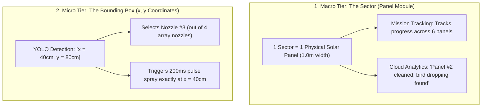
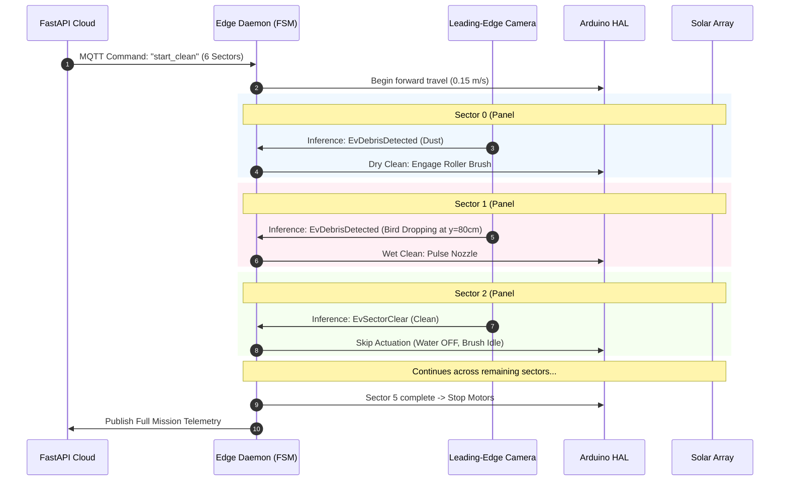

# Physical, Optical & Operational Model

## 1. Overview & Spatial Layout

The **Solar Sweeper** is an autonomous, self-propelled cleaning gantry designed to clean long strings of utility-scale solar panels arranged side-by-side in continuous rows.

```
                      GANTRY TRAVEL DIRECTION (To the Right ──►)
  ════════════════════════════════════════════════════════════════════════════════════════════════════►
 ┌────────────────────────────────────────────────────────────────────────────────────────────────────┐
 │                                   SOLAR PANEL ARRAY (Top View)                                     │
 ├────────────────┬────────────────┬────────────────┬────────────────┬────────────────┬───────────────┤
 │    Sector 0    │    Sector 1    │    Sector 2    │    Sector 3    │    Sector 4    │    Sector 5   │
 │   (Panel #1)   │   (Panel #2)   │   (Panel #3)   │   (Panel #4)   │   (Panel #5)   │   (Panel #6)  │
 │                │                │                │                │                │               │
 │    [ Dust ]    │ [Bird Dropping]│  [ Clean ✨ ]  │    [ Leaf ]    │    [ Dust ]    │ [Bird Dropping]
 │                │                │                │                │                │               │
 ├────────────────┴────────────────┴────────────────┴────────────────┴────────────────┴───────────────┤
 └────────────────────────────────────────────────────────────────────────────────────────────────────┘
        │                │                │                │                │                │
        ▼                ▼                ▼                ▼                ▼                ▼
   [Dry Sweep]      [Spot Spray]       [SKIPPED]      [Dry Sweep]      [Dry Sweep]      [Spot Spray]
    (Brush ON)      (Nozzle #3 Pulse) (0ml Water)      (Brush ON)       (Brush ON)      (Nozzle #2 Pulse)
```

---

## 2. The Gantry Tooling Assembly

The robotic cleaning machine spans across the vertical panel height and moves **horizontally to the right** as a single integrated vehicle.

```
                               TRAVEL DIRECTION (Rightward ──►)
 ─────────────────────────────────────────────────────────────────────────────────────────────
   [ SPINNING ROLLER BRUSH ]       [ WATER NOZZLE MANIFOLD ]            [ LOOK-AHEAD CAMERA ]
        (Trailing Edge)                    (Middle)                        (Leading Edge)
 ─────────────────────────────────────────────────────────────────────────────────────────────
          ▲                                ▲                                     ▲
          │                                │                                     │
   Scrubs & sweeps panel           Opens targeted nozzle                Scans panel 20cm ahead
   as robot rolls over spot        for 200ms burst                      as robot rolls forward
```

### Tool Arrangement (Front to Back):
1. **Front (Leading Edge):** **Look-Ahead Camera** scans the panel surface ahead of the cleaning tools.
2. **Middle:** **Multi-Nozzle Solenoid Manifold** delivers precision high-pressure water pulses only onto detected stubborn debris.
3. **Rear (Trailing Edge):** **Spinning Cylindrical Roller Brush** sweeps loose dust and scrubs the pre-softened spot clean.

---

## 3. Continuous Motion Kinematics (No Stopping Required)

The machine **does not need to stop at every panel**. It traverses continuously while streaming inferences:

```
Speed (v)            = 0.15 m/s (~9 meters per minute)
Look-Ahead Distance  = 20 cm (Camera is 20 cm ahead of nozzles)
AI Inference Latency = ~80 ms (YOLO model forward pass)
Travel during AI Run = 0.15 m/s × 0.08 s = 1.2 cm!
```

* **How it works in motion:** By the time the AI finishes classifying an image ($80\text{ ms}$), the robot has only moved **$1.2\text{ cm}$**. 
* The State Machine has ample time to trigger the water spray valve right as the nozzle passes over the target coordinate.

---

## 4. The Two-Tier Spatial Hierarchy: Macro vs. Micro

To balance clean cloud analytics with sub-centimeter hardware precision, the system operates on two distinct spatial tiers:



### Why this distinction matters:
* **`Sector` (Macro):** Used by the **State Machine** and **FastAPI Cloud Dashboard** to track mission milestones and per-panel health.
* **`Bounding Box` (Micro):** Used by the **Hardware HAL / Arduino** to trigger specific solenoid pins for targeted spot-cleaning, saving **$> 85\%$ of water** compared to traditional full-panel wash systems.

---

## 5. Optical Mounting & Field of View (FOV) Calculation

To ensure a single camera can inspect the full height of the panel array as the robot moves right:

$$\text{Mounting Height } (D) = \frac{\text{Panel Height } (H)}{2 \times \tan\left(\frac{\text{Lens FOV Angle }}{2}\right)}$$

### Real-World Geometry:
* **Panel Height ($H$):** $1.0\text{ m}$ to $1.7\text{ m}$
* **Lens Selection:** **$120^\circ$ Wide-Angle Lens** (e.g., *Raspberry Pi Camera Module 3 Wide*)
* **Calculation:**
  $$D = \frac{1.7\text{ m}}{2 \times \tan(60^\circ)} = \frac{1.7\text{ m}}{2 \times 1.732} \approx \mathbf{0.49\text{ m} \ (49\text{ cm})}$$

### Hardware Recommendation:
* Mount the camera **$35\text{ cm}$ to $45\text{ cm}$** above the panel surface on a rigid central mast at the leading bumper of the gantry.

---

## 6. End-to-End Operational Lifecycle Trace


