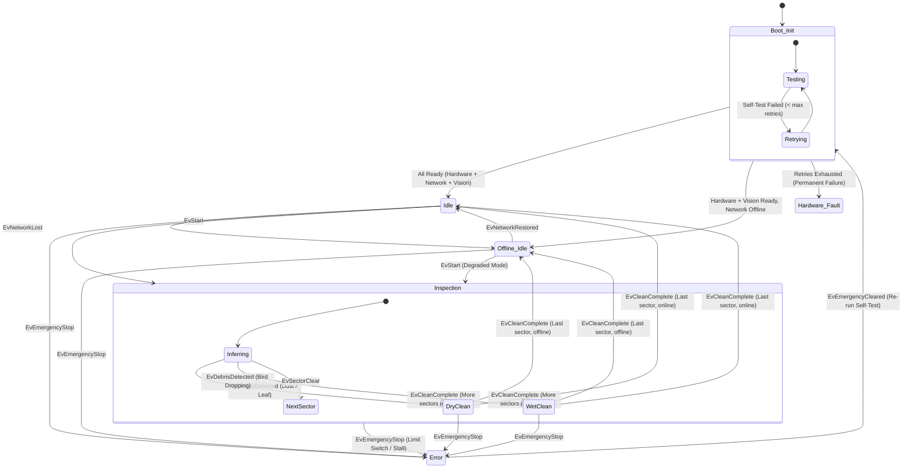

# State Machine & Operational Lifecycle Guide

## 1. Overview & Full State Diagram

The **Solar Sweeper Edge Daemon** implements its central control logic using **TinyFSM**. The State Machine contains 8 discrete states designed to ensure that the robotic gantry is always in a mathematically well-defined, safe condition.



---

## 2. Comprehensive State Matrix

| State Name | Operational Role | Entry Actions (`entry()`) | Exit Actions (`exit()`) | Valid Transitions Out |
|---|---|---|---|---|
| **`Boot_Init`** | Hardware self-test, model warmup, and network handshake. | Requests hardware ping, initializes MQTT, warms up ONNX model. Resets retry count. | None. | $\to$ `Idle`<br>$\to$ `Offline_Idle`<br>$\to$ `Hardware_Fault` |
| **`Idle`** | Online standby awaiting cloud missions. | Parks actuators safely via `stopActuators()`. | None. | $\to$ `Inspection`<br>$\to$ `Offline_Idle`<br>$\to$ `Error` |
| **`Offline_Idle`** | Offline standby awaiting connection or manual trigger. | Parks actuators safely. Logs telemetry to disk cache. | None. | $\to$ `Idle`<br>$\to$ `Inspection`<br>$\to$ `Error` |
| **`Inspection`** | Gantry aligned at sector; camera inspecting panel surface. | Requests asynchronous vision inference for `currentSectorIndex`. | None. | $\to$ `DryClean`<br>$\to$ `WetClean`<br>$\to$ `Idle` / `Offline_Idle`<br>$\to$ `Error` |
| **`DryClean`** | Mechanical sweeping (roller brush + linear travel). | Dispatches `beginDryClean(sector)` to Hardware HAL. | Calls `stopActuators()`. | $\to$ `Inspection`<br>$\to$ `Idle` / `Offline_Idle`<br>$\to$ `Error` |
| **`WetClean`** | Fluid wash + brush (water solenoid + pump + roller brush). | Dispatches `beginWetClean(sector)` to Hardware HAL. | Calls `stopActuators()`. | $\to$ `Inspection`<br>$\to$ `Idle` / `Offline_Idle`<br>$\to$ `Error` |
| **`Error`** | Safety halt triggered by mechanical E-Stop or operator abort. | Immediately executes `emergencyHalt()`. Latches E-Stop reason. | None. | $\to$ `Boot_Init` (via `EvEmergencyCleared`) |
| **`Hardware_Fault`** | Terminal failure when boot self-test retries are exhausted. | Logs fatal hardware fault to console and telemetry. | None (Terminal within process). | Requires process restart or service reboot. |

---

## 3. Event Catalog

All events are strongly typed C++ structs unified under `sse::core::EventVariant`:

```cpp
using EventVariant = std::variant<
    events::EvStart,
    events::EvDebrisDetected,
    events::EvSectorClear,
    events::EvCleanComplete,
    events::EvEmergencyStop,
    events::EvEmergencyCleared,
    events::EvNetworkLost,
    events::EvNetworkRestored,
    events::EvBootHardwareReady,
    events::EvBootNetworkReady,
    events::EvBootVisionReady,
    events::EvBootHardwareFailed,
    events::EvBootVisionFailed
>;
```

| Event Struct | Source | Description |
|---|---|---|
| `EvStart` | Cloud MQTT / Console | Commands the robot to begin an automated sweep starting from sector 0. |
| `EvDebrisDetected` | Vision AI Engine | Carries `sectorId`, `debrisType` (`Dust`, `Leaf`, `BirdDropping`), and `confidence`. |
| `EvSectorClear` | Vision AI Engine | Indicates that the inspected sector has no detectable debris. |
| `EvCleanComplete` | Arduino HAL | Transmitted when the physical roller brush sweep for a sector finishes. |
| `EvEmergencyStop` | Arduino HAL / Cloud / Console | Carries failure `reason` (e.g. `limit_switch_hit`, `motor_stall`, `operator_abort`). |
| `EvEmergencyCleared` | Console / Cloud Reset | Clears the latch and returns to `Boot_Init` for a fresh self-test. |
| `EvNetworkLost` | Network Thread | Notifies FSM of MQTT ping failure or Wi-Fi disconnection. |
| `EvNetworkRestored` | Network Thread | Notifies FSM that cloud connectivity has been re-established. |
| `EvBootHardwareReady` | Arduino HAL | Confirms Arduino replied to ping handshake (`0xA0`). |
| `EvBootHardwareFailed` | Arduino HAL | Transmitted on serial timeout or port open failure. |
| `EvBootVisionReady` | Vision Engine | Confirms ONNX model loaded and dummy warm-up inference passed. |
| `EvBootNetworkReady` | Network Thread | Confirms MQTT broker connection established during boot. |

---

## 4. Key Edge Cases & Multi-Threaded Fail-Safes

### Case A: Network Drops Mid-Cleaning Cycle
* **Behavior:** If Wi-Fi drops while the robot is in `DryClean` or `WetClean`, the daemon **does not abort the mechanical sweep**. Stopping mid-panel could leave wet sludge or obstruct gantry mechanisms.
* **Resolution:** The robot safely finishes the active sector pass, transitions through remaining sectors, and lands in **`Offline_Idle`** instead of `Idle`. Telemetry is persisted to disk and flushed once the network returns.

### Case B: Boot Self-Test Failure & Escalation
* **Behavior:** If the Arduino does not respond to the boot ping (`0x00`) within `boot_timeout_ms`, `Boot_Init` increments its internal retry counter.
* **Resolution:** It retries up to `boot_max_retries` (default: 3). If all retries fail, it escalates to `Hardware_Fault`, refusing to enter `Idle` and alerting the system.

### Case C: Race Condition Guarding (E-Stop vs Queued Events)
* **Behavior:** Suppose an `EvStart` or `EvCleanComplete` was pushed to the queue at timestamp $T_1$, but at $T_2$ a limit switch hit tripped `g_estop_flag`.
* **Resolution:** When the State Machine pops the event at $T_3$, `IdleStateBase::react(EvStart)` and `CleaningStateBase::react(EvCleanComplete)` check `IsEstopActive()`. The stale event is **safely discarded**, preventing unwanted motion.
